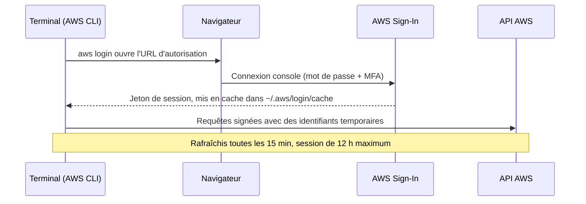
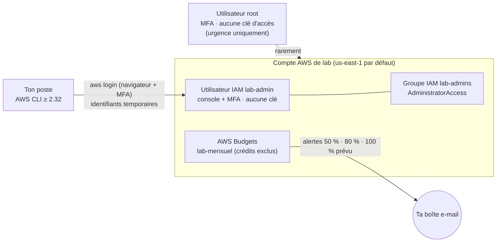

# Leçon 0 — Sécuriser son compte de lab AWS

> **Module :** préalable au M1 · **Difficulté :** ★ · **Durée :** ~2 h (théorie 40 min, lab 1 h 20)
> **Domaine d'examen :** D1.1 (accès sécurisés), D4 (maîtrise des coûts)
> **Corrigé :** fichier séparé `lecon-00-corrige.md`. Ne l'ouvre qu'après avoir répondu aux questions et aux exercices.

Légende utilisée dans tout le cours :
- 📘 **Fait documenté** : vérifié dans la documentation AWS.
- 🏗️ **Recommandation d'architecture** : bonne pratique, discutable selon le contexte.
- ✂️ **Simplification pédagogique** : volontairement simplifié pour ce stade du cours.

---

## Partie théorique

### 1. Le problème

Tu vas passer environ 145 heures à créer des VPC, des bases de données et des fonctions Lambda dans un compte AWS personnel, lié à ta carte bancaire.

Deux risques réels menacent ce compte :

1. **La compromission des identifiants.** Une clé d'accès poussée par erreur sur GitHub, ou un mot de passe root sans MFA, suffit à quelqu'un pour lancer des ressources à tes frais (minage de cryptomonnaie, en général). Le modèle de responsabilité partagée s'applique ici directement : AWS sécurise le cloud, mais la sécurité de *tes identités dans* le cloud est ta responsabilité.
2. **La dérive des coûts.** Une NAT Gateway oubliée, une base RDS Multi-AZ laissée allumée un week-end : rien de catastrophique isolément, mais personne ne te prévient par défaut.

**Contraintes :**
- Aucune clé d'accès permanente sur ton poste.
- Le compte root n'est jamais utilisé au quotidien.
- Tu es alerté *avant* qu'un oubli ne devienne coûteux.
- Le tout ne coûte rien.

**Ce qui se passe avec de mauvais choix :** utiliser root avec des clés d'accès dans `~/.aws/credentials` revient à garder la clé maîtresse du bâtiment dans sa poche, sans possibilité de restreindre ce qu'elle ouvre. Si elle fuit, le rayon d'impact est *tout le compte, y compris sa fermeture et la facturation*.

### 2. L'idée fondamentale

**Intuition.** On sépare trois choses : *qui tu es* (identité), *ce que tu as le droit de faire* (permissions) et *combien de temps la preuve de ton identité reste valable* (durée de vie des identifiants). On veut une identité du quotidien distincte de root, et des preuves qui expirent seules.

**Technique.**
- 📘 L'**utilisateur root** a un accès total et non restreignable par IAM dans un compte autonome. On le protège (MFA, aucune clé d'accès) et on le range.
- 📘 Une **identité IAM** (utilisateur, ou mieux, rôle assumé) reçoit des permissions par des policies.
- 📘 Des **identifiants temporaires** (émis via STS ou par des mécanismes de connexion) expirent automatiquement. Une fuite a donc une fenêtre d'exploitation limitée.
- 📘 **AWS Budgets** surveille les coûts et envoie des alertes. C'est un contrôle **détectif**, pas préventif : il ne bloque rien par défaut.

**À retenir :** *réduire le rayon d'impact* (qui peut faire quoi) et *réduire la fenêtre d'exposition* (combien de temps). Tu retrouveras ce raisonnement dans chaque module de sécurité.

### 3. Les mécanismes

#### 3.1 Les types d'identifiants

| Identifiant | Durée de vie | Risque si fuite |
|---|---|---|
| Mot de passe root + MFA | Permanent | Faible grâce au MFA, mais rayon d'impact total |
| Clés d'accès root | Permanentes | **Critique.** À ne jamais créer |
| Clés d'accès d'un utilisateur IAM | Permanentes (jusqu'à rotation manuelle) | Élevé |
| Identifiants temporaires (`aws login`, SSO, rôle assumé) | Minutes à heures | Limité dans le temps |

#### 3.2 `aws login` : des identifiants temporaires sans clés d'accès

📘 Depuis novembre 2025, la commande `aws login` (AWS CLI **≥ 2.32.0**) permet d'utiliser ta connexion console pour obtenir des identifiants temporaires. Elle fonctionne avec root, un utilisateur IAM ou une identité fédérée avec IAM. Pour IAM Identity Center, on utilise plutôt `aws configure sso`.

📘 Les identifiants sont rafraîchis automatiquement toutes les 15 minutes. La session dure au maximum la durée de session configurée pour l'identité, plafonnée à **12 heures**. Le cache est stocké dans `~/.aws/login/cache`.

📘 L'identité IAM doit avoir la managed policy `SignInLocalDevelopmentAccess`, ou des permissions équivalentes. `AdministratorAccess` (`"Action": "*"`) les inclut.



#### 3.3 IAM Identity Center et l'impact du plan gratuit

📘 IAM Identity Center, dans sa forme utile pour accéder à des comptes AWS (l'« instance d'organisation »), repose sur **AWS Organizations**.

📘 **Point critique pour toi :** si ton compte a été créé après le 15 juillet 2025 et qu'il est sur le **plan gratuit** (Free account plan), l'inscription à AWS Organizations le **fait passer automatiquement au plan payant**, et tu perds l'accès aux crédits du Free Tier ainsi que la possibilité d'en gagner de nouveaux.

📘 Le plan gratuit dure 6 mois ou jusqu'à épuisement des crédits (100 USD à l'inscription, jusqu'à 200 USD avec les activités). Ensuite, le compte est fermé si tu ne passes pas au plan payant. Certains services gourmands n'y sont pas disponibles.

C'est donc une **vraie décision d'architecture**, et on la traite comme telle à la section 4.

#### 3.4 AWS Budgets

- 📘 La surveillance et les notifications des budgets sont **gratuites**. Les deux premiers budgets avec actions sont gratuits chaque mois. Les rapports de budget coûtent 0,01 USD par rapport envoyé.
- 📘 Par défaut, un budget de coût **inclut les crédits** (`IncludeCredit = true`). Sur un compte qui consomme des crédits, ton budget afficherait donc environ 0 USD pendant que tu brûles tes crédits. On les exclut pour voir la consommation brute.
- 📘 Une alerte peut porter sur le coût **réel** (`ACTUAL`) ou **prévu** (`FORECASTED`).
- 🏗️ Les données de facturation ne sont pas instantanées : il peut s'écouler plusieurs heures entre une dépense et l'alerte. Le délai exact n'est pas garanti, ne compte pas dessus pour réagir en temps réel.

#### 3.5 Les tags

🏗️ Un tag est une paire clé/valeur posée sur une ressource. On fixe dès maintenant une convention qui servira à retrouver et supprimer les ressources, puis à répartir les coûts au module 12 :

| Clé | Exemple | Usage |
|---|---|---|
| `Project` | `saa-lab` | Isoler tout ce qui relève du cours |
| `Lesson` | `m4-l2` | Retrouver la leçon d'origine au nettoyage |
| `Owner` | ton prénom | Utile dès qu'on simule plusieurs équipes |
| `Environment` | `lab` | Prépare les scénarios multi-environnements |

📘 Pour apparaître dans les rapports de coûts, un tag doit être **activé** comme *cost allocation tag* dans la console Billing. Il ne devient activable qu'après avoir été utilisé sur une ressource. On le fera au M12.

### 4. Les décisions architecturales

**Décision 1 — Comment accéder au compte au quotidien ?**

| Option | Sécurité | Effort | Prérequis | Verdict |
|---|---|---|---|---|
| Root + clés d'accès | ❌ Critique | Nul | — | Jamais |
| Utilisateur IAM + clés d'accès | ⚠️ Clés permanentes | Faible | — | À éviter |
| **A.** Utilisateur IAM + MFA + `aws login` | ✅ Identifiants temporaires | Faible | CLI ≥ 2.32 | ✅ Recommandé sur plan gratuit |
| **B.** IAM Identity Center + `aws configure sso` | ✅✅ Aucun utilisateur IAM, identités centralisées | Moyen | Organizations, donc plan payant | ✅ Recommandé sur plan payant ou ancien compte |

**Décision 2 — Rester sur le plan gratuit ou passer au plan payant ?**

| Critère | Plan gratuit | Plan payant |
|---|---|---|
| Risque de facture | Aucun pendant la période gratuite | Facturation au-delà des crédits |
| Services | Certains services gourmands indisponibles | Tous |
| Organizations, SCP, Identity Center | ❌ (leur activation déclenche le passage au plan payant) | ✅ |
| Durée | 6 mois max, puis fermeture sans passage au payant | Illimitée |

🏗️ **Recommandation :**
- Si tu es sur le **plan gratuit** : prends l'option **A** maintenant. On reconsidère le passage au plan payant au **M2**, où Organizations et les SCP deviennent nécessaires pour les labs, et à la date d'expiration des 6 mois (le cours dure 3 à 4 mois, cela peut suffire).
- Si tu es sur le **plan payant** ou sur un **compte antérieur au 15/07/2025** : prends directement l'option **B**.

📘 Dans les deux cas, les crédits non utilisés restent valables jusqu'à 12 mois après l'inscription si tu passes au plan payant.

**Décision 3 — Quelle Région par défaut ?**

🏗️ Pour toi, depuis Haïti : **us-east-1 (Virginie du Nord)**. C'est la Région la plus proche, celle où les nouveautés arrivent en général en premier, et parmi les moins chères. On utilisera **us-west-2 (Oregon)** comme Région secondaire au M10.

Attention : us-east-1 a aussi des particularités qu'on exploitera, par exemple les certificats ACM pour CloudFront et les métriques de facturation CloudWatch.

### 5. Exemple concret

Une startup de 3 développeurs a un seul compte AWS. Le CTO a créé des clés d'accès root « pour aller vite » et les a mises dans un fichier `.env`. Six mois plus tard, le dépôt devient public par erreur.

En quelques minutes, des robots qui scannent GitHub récupèrent les clés et lancent des dizaines d'instances GPU dans plusieurs Régions. La seule chose qui alerte l'équipe est la facture.

Ce qu'aurait apporté l'architecture de cette leçon :
- **Aucune clé root** : la fuite n'aurait pas eu le pouvoir de tout faire.
- **Des identifiants temporaires** : même un jeton volé expire en quelques heures.
- **Un budget avec alerte sur le prévu** : l'équipe aurait été prévenue dès que la prévision de fin de mois aurait dépassé le seuil, en quelques heures plutôt qu'en fin de mois.
- **Pour aller plus loin** (M2, M12) : des SCP qui interdisent les Régions inutilisées, et des actions de budget qui appliquent une policy de refus.

### 6. Pièges de l'examen

- **« Sécuriser le compte root » :** les bonnes réponses sont *activer le MFA* et *ne pas créer ou supprimer les clés d'accès root*. Partager root avec l'équipe, même avec MFA, est un distracteur.
- **Certaines tâches exigent root** (fermer le compte, changer l'adresse e-mail ou le mot de passe root, certains réglages de facturation). Une réponse « supprimer complètement root » n'existe pas dans un compte autonome.
- **Budgets ou alarme de facturation CloudWatch ?** Les deux peuvent alerter. L'alarme CloudWatch se base sur la métrique `EstimatedCharges`, publiée uniquement en **us-east-1**, et porte sur le réel. Budgets gère nativement le **prévisionnel**, les filtres par service ou tag, et les **actions**. Si l'énoncé dit « avant que le coût prévu ne dépasse », pense Budgets.
- **« Empêcher » ou « être alerté » :** une alerte ne bloque rien. Pour *empêcher*, il faut un contrôle préventif : SCP, policy IAM, ou action de budget qui applique l'une ou l'autre. Lis bien le verbe de l'énoncé.
- **Plusieurs comptes et des développeurs qui ont besoin de la CLI :** IAM Identity Center avec des permission sets. Créer un utilisateur IAM par développeur et par compte est un distracteur classique (fonctionnel, mais non scalable et à identifiants permanents).

### 7. Résumé

**Concepts essentiels :** rayon d'impact et fenêtre d'exposition · root ≠ identité du quotidien · identifiants temporaires plutôt que clés permanentes · Budgets est détectif · tags dès le premier jour.

**Décisions à savoir prendre :** comment fournir un accès CLI sans clés · Budgets ou alarme de facturation · contrôle préventif ou détectif.

**Erreurs à éviter :** clés d'accès root · budget qui inclut les crédits (et donc affiche 0 USD) · croire qu'une alerte arrête la dépense.

**Questions de vérification** (réponds dans le chat avant d'ouvrir le corrigé) :
1. Pourquoi un identifiant temporaire volé est-il moins grave qu'une clé d'accès volée, alors que les deux donnent les mêmes permissions au moment du vol ?
2. Ton budget à 10 USD n'a jamais envoyé d'alerte, mais ton solde de crédits a baissé de 25 USD. Quelle est l'explication la plus probable ?
3. Pourquoi l'option B (Identity Center) est-elle supérieure à l'option A, et pourquoi ne la choisit-on pas forcément tout de suite ?

**Questions de type SAA-C03 :**

**Q1.** Une entreprise gère 12 comptes AWS dans AWS Organizations. Ses 40 développeurs doivent utiliser la CLI dans plusieurs comptes avec des permissions différentes selon le compte. L'équipe sécurité interdit les identifiants permanents. Quelle solution répond aux exigences avec le moins d'effort opérationnel ?
- A. Créer un utilisateur IAM par développeur dans chaque compte et imposer la rotation des clés tous les 90 jours.
- B. Activer IAM Identity Center, créer des permission sets et les attribuer par compte ; les développeurs utilisent `aws configure sso`.
- C. Créer des utilisateurs IAM dans un compte central avec des clés d'accès, puis des rôles assumables dans chaque compte.
- D. Partager un rôle d'administration par compte, dont les identifiants sont stockés dans Secrets Manager.

**Q2.** Une startup veut être prévenue par e-mail dès que ses dépenses **prévues** pour le mois dépassent 500 USD, avec le moins de développement possible. Que doit-elle faire ?
- A. Créer une alarme CloudWatch sur la métrique `EstimatedCharges` dans la Région de ses ressources.
- B. Créer un budget de coût AWS Budgets avec une notification de type FORECASTED.
- C. Écrire une fonction Lambda planifiée qui interroge Cost Explorer et publie sur SNS.
- D. Activer AWS Cost Anomaly Detection avec un seuil de 500 USD.

**Q3.** Quelles actions suivent les bonnes pratiques pour l'utilisateur root d'un compte autonome ? *(Choisis-en DEUX.)*
- A. Activer le MFA sur l'utilisateur root.
- B. Créer des clés d'accès root pour la pipeline CI/CD, stockées dans Secrets Manager.
- C. Supprimer les clés d'accès root existantes et utiliser des identités IAM pour les tâches courantes.
- D. Partager les identifiants root avec les administrateurs, protégés par MFA.
- E. Utiliser root pour l'administration quotidienne, mais seulement depuis le réseau de l'entreprise.

---

## Lab pratique — Niveau 1 : un compte de lab sûr et surveillé

### A. Objectif

À la fin du lab, tu auras :

| Objectif pratique | Concept de la leçon |
|---|---|
| Root protégé par MFA, sans clé d'accès, non utilisé ensuite | Rayon d'impact (§2) |
| Une identité d'administration distincte, avec MFA | Root ≠ identité du quotidien (§4, décision 1) |
| Une CLI qui fonctionne **sans aucune clé d'accès** | Identifiants temporaires (§3.2) |
| Un budget qui mesure la consommation **brute** (crédits exclus) | Budgets détectif (§3.4) |
| Une convention de tags écrite | Tags (§3.5) |
| Un choix argumenté entre les options A et B | Décisions 1 et 2 (§4) |

### B. Scénario

Tu es l'architecte de « Lab-SAA », un environnement dans lequel une seule personne (toi) va construire puis détruire des architectures pendant plusieurs mois. L'exigence métier : *aucun incident de sécurité et aucune surprise de facturation*, sans payer d'outil supplémentaire.

### C. Architecture cible (option A)



- **Root :** sert uniquement aux tâches qui l'exigent.
- **Groupe `lab-admins` :** porte les permissions. 🏗️ On attache les policies à un groupe plutôt qu'à l'utilisateur pour séparer l'identité de ses droits.
- **Utilisateur `lab-admin` :** ton identité quotidienne, en console comme en CLI.
- **Budgets :** t'alerte par e-mail.

✂️ `AdministratorAccess` est volontairement large : ton compte de lab a besoin de tout créer. Au M2, on construira des rôles plus restreints, et tu verras pourquoi ce choix serait inacceptable en production.

> **Option B** (plan payant ou ancien compte) : remplace l'utilisateur IAM par un utilisateur IAM Identity Center avec un permission set `AdministratorAccess`. Voir l'étape 5-B.

### D. Prérequis

- Un compte AWS dont tu es propriétaire, **personnel et dédié** (jamais celui de ton employeur).
- Une application d'authentification (Google Authenticator, Authy, 1Password, etc.) ou une clé de sécurité / passkey.
- Un navigateur sur le même poste que ton terminal (sinon, `aws login --remote`).
- Un terminal local : macOS, Linux, ou Windows avec PowerShell ou WSL.
- Aucune connaissance préalable au-delà du Cloud Practitioner.

**Coût du lab : 0 USD.** IAM, la surveillance par Budgets et CloudShell n'entraînent aucun frais. Organizations et IAM Identity Center (option B) sont aussi sans frais, mais attention à l'effet de leur activation sur le plan gratuit (§3.3).

### E. Instructions de réalisation

> **Règle permanente du cours :** ne colle jamais dans le chat un mot de passe, un code MFA, une clé ou un jeton. Tu peux masquer ton ID de compte (`1234…`) dans les sorties que tu me montres.

#### Étape 1 — Faire l'état des lieux (console, en root)

1. Connecte-toi à la console avec l'adresse e-mail root.
2. Repère ton plan : widget **Cost and Usage** de la page d'accueil, ou console **Billing and Cost Management**. Note s'il s'agit du plan gratuit, du plan payant, ou d'un ancien compte (antérieur au 15/07/2025).
3. En haut à droite, sélectionne la Région **US East (N. Virginia) us-east-1**.

✅ **Résultat attendu :** tu sais quel plan s'applique. Il détermine ton option (A ou B).

#### Étape 2 — Protéger root (console)

1. Menu du compte (en haut à droite) → **Security credentials**.
2. Section **Multi-factor authentication (MFA)** : si aucun dispositif n'apparaît, **Assign MFA device** et suis l'assistant. 🏗️ Enregistre idéalement deux dispositifs (par exemple, l'application sur ton téléphone et une clé de sécurité) pour ne pas perdre l'accès si tu perds ton téléphone.
3. Section **Access keys** : il ne doit y avoir **aucune** clé. S'il y en a, désactive-les puis supprime-les.
4. Range le mot de passe root dans un gestionnaire de mots de passe.

#### Étape 3 — Autoriser IAM à voir la facturation (console, en root)

Sans cette étape, ton administrateur IAM ne pourra pas gérer Budgets.

1. Menu du compte → **Account**.
2. Section **IAM user and role access to Billing information** → **Edit** → coche **Activate IAM Access** → **Update**.

#### Étape 4 — Créer l'identité d'administration (option A)

> **Option B ?** Passe directement à l'étape 5-B.

1. Ouvre **AWS CloudShell** (icône `>_` dans la barre du haut). Tu es encore root : c'est l'un des rares usages légitimes, pour amorcer le compte.
2. Définis tes variables :

```bash
export LAB_USER="lab-admin"
export OWNER="ton-prenom"   # à adapter
```

3. Crée une politique de mots de passe pour les utilisateurs IAM :

```bash
aws iam update-account-password-policy \
  --minimum-password-length 14 \
  --require-symbols --require-numbers \
  --require-uppercase-characters --require-lowercase-characters \
  --allow-users-to-change-password
```

4. Crée le groupe et attache la policy :

```bash
aws iam create-group --group-name lab-admins
aws iam attach-group-policy --group-name lab-admins \
  --policy-arn arn:aws:iam::aws:policy/AdministratorAccess
```

5. Crée l'utilisateur, tagué selon la convention, et ajoute-le au groupe :

```bash
aws iam create-user --user-name "$LAB_USER" \
  --tags Key=Project,Value=saa-lab Key=Lesson,Value=l0 Key=Owner,Value="$OWNER" Key=Environment,Value=lab
aws iam add-user-to-group --user-name "$LAB_USER" --group-name lab-admins
```

6. Vérifie :

```bash
aws iam get-group --group-name lab-admins --query 'Users[].UserName'
aws iam list-attached-group-policies --group-name lab-admins
```

✅ **Résultat attendu :** `["lab-admin"]`, et la policy `AdministratorAccess` attachée au groupe.

7. **Accès console (par la console, pour que le mot de passe ne passe jamais par l'historique du shell) :** IAM → **Users** → `lab-admin` → onglet **Security credentials** → **Enable console access** → choisis un **mot de passe personnalisé** fort. Tu peux laisser décochée l'obligation de le changer à la première connexion, puisque c'est toi.
8. Facultatif mais pratique : crée un alias de compte, qui donne une URL de connexion lisible. Le nom doit être **globalement unique**.

```bash
aws iam create-account-alias --account-alias "saa-lab-$OWNER"
aws iam list-account-aliases
```

9. Note l'URL de connexion IAM affichée sur le tableau de bord IAM (**Sign-in URL for IAM users**), puis **déconnecte-toi de root**.

#### Étape 5-A — MFA de l'utilisateur et CLI sans clés (option A)

1. Connecte-toi via l'URL IAM avec `lab-admin`.
2. Menu du compte → **Security credentials** → **Assign MFA device**.
3. Déconnecte-toi, puis reconnecte-toi : le code MFA doit être demandé.
4. Sur **ton poste**, installe ou mets à jour l'AWS CLI v2 (guide : https://docs.aws.amazon.com/cli/latest/userguide/getting-started-install.html), puis vérifie la version :

```bash
aws --version
# Attendu : aws-cli/2.32.0 ou plus récent
```

5. Connecte la CLI avec un profil nommé `lab` :

```bash
aws login --profile lab
# Région demandée : us-east-1
# Dans le navigateur : choisis la session lab-admin (ou connecte-toi avec mot de passe + MFA)
```

6. Pour ne pas répéter `--profile` à chaque commande (macOS / Linux / WSL) :

```bash
export AWS_PROFILE=lab
```

Sous PowerShell : `$env:AWS_PROFILE = "lab"`.

7. Regarde ce qui a été écrit. Tu dois voir une entrée `login_session` et **aucun** `aws_access_key_id` :

```bash
cat ~/.aws/config
ls ~/.aws/credentials 2>/dev/null || echo "Aucun fichier credentials : parfait"
```

#### Étape 5-B — IAM Identity Center et CLI (option B uniquement)

> ⚠️ Sur un compte au **plan gratuit**, cette étape crée une organisation et fait **passer le compte au plan payant** (§3.3). Ne la fais que si c'est un choix délibéré.

1. En root, console → **IAM Identity Center** → **Enable**. Choisis l'activation avec AWS Organizations (instance d'organisation) dans **us-east-1**. Une organisation est créée si tu n'en as pas, et ton compte en devient le compte de gestion.
2. **Users** → **Add user** : ton utilisateur, avec ton e-mail. Active le MFA dans **Settings → Authentication**.
3. **Permission sets** → **Create** → *Predefined* → `AdministratorAccess`.
4. **AWS accounts** → sélectionne ton compte → **Assign users or groups** → ton utilisateur + le permission set.
5. Note l'**AWS access portal URL** (page **Settings** ou **Dashboard**).
6. Sur ton poste :

```bash
aws configure sso
# SSO session name : saa-lab
# SSO start URL : <ton AWS access portal URL>
# SSO region : us-east-1
# SSO registration scopes : sso:account:access (valeur par défaut)
# Choisis ton compte et le rôle AdministratorAccess
# Default client Region : us-east-1 · Output format : json · Profile name : lab
aws sso login --profile lab
export AWS_PROFILE=lab
```

🏗️ Avec l'option B, tu n'as pas besoin de l'utilisateur IAM `lab-admin` de l'étape 4 : moins d'identités, c'est moins de surface d'attaque.

#### Étape 6 — Créer le budget (CLI, avec ton profil `lab`)

1. Définis tes variables. L'adresse e-mail reste sur ton poste, ne la colle pas dans le chat :

```bash
export ACCOUNT_ID=$(aws sts get-caller-identity --query Account --output text)
export ALERT_EMAIL="ton.adresse@exemple.com"   # à adapter
export BUDGET_USD="10"                          # ajuste à ta tolérance
```

2. Écris la définition du budget. Les crédits et remboursements sont exclus pour voir la consommation brute :

```bash
cat > budget.json <<EOF
{
  "BudgetName": "lab-mensuel",
  "BudgetLimit": { "Amount": "${BUDGET_USD}", "Unit": "USD" },
  "TimeUnit": "MONTHLY",
  "BudgetType": "COST",
  "CostTypes": { "IncludeCredit": false, "IncludeRefund": false }
}
EOF
```

3. Écris les trois notifications : 50 % réel, 80 % réel et 100 % prévu :

```bash
cat > notifications.json <<EOF
[
  { "Notification": { "NotificationType": "ACTUAL", "ComparisonOperator": "GREATER_THAN", "Threshold": 50, "ThresholdType": "PERCENTAGE" },
    "Subscribers": [ { "SubscriptionType": "EMAIL", "Address": "${ALERT_EMAIL}" } ] },
  { "Notification": { "NotificationType": "ACTUAL", "ComparisonOperator": "GREATER_THAN", "Threshold": 80, "ThresholdType": "PERCENTAGE" },
    "Subscribers": [ { "SubscriptionType": "EMAIL", "Address": "${ALERT_EMAIL}" } ] },
  { "Notification": { "NotificationType": "FORECASTED", "ComparisonOperator": "GREATER_THAN", "Threshold": 100, "ThresholdType": "PERCENTAGE" },
    "Subscribers": [ { "SubscriptionType": "EMAIL", "Address": "${ALERT_EMAIL}" } ] }
]
EOF
```

4. Crée le budget :

```bash
aws budgets create-budget \
  --account-id "$ACCOUNT_ID" \
  --budget file://budget.json \
  --notifications-with-subscribers file://notifications.json
```

✅ **Résultat attendu :** aucune sortie, ce qui est normal pour cette commande en cas de succès.

#### Étape 7 — Écrire ta convention de tags

Crée un fichier `conventions.md` dans le dossier où tu garderas tous tes labs (idéalement un dépôt Git **privé**) :

```markdown
# Conventions Lab-SAA
- Région par défaut : us-east-1 · Région secondaire : us-west-2
- Tags obligatoires : Project=saa-lab, Lesson=<module-leçon>, Owner=<prénom>, Environment=lab
- Nommage des stacks CloudFormation : saa-<module>-<leçon>-<objet> (ex. saa-m4-l1-vpc)
- Règle : tout lab se termine par son nettoyage et une vérification
```

#### Étape 8 — Prendre ta décision A ou B

Écris 3 à 5 lignes, dans ton `conventions.md` et dans le chat : quel plan, quelle option, et à quel moment tu reconsidéreras ce choix.

### F. Tests et validation

| # | Type | Commande ou action | Résultat attendu |
|---|---|---|---|
| T1 | Fonctionnement | `aws sts get-caller-identity` | Un ARN `arn:aws:iam::<compte>:user/lab-admin` (option A) ou `…:assumed-role/AWSReservedSSO_AdministratorAccess_…/…` (option B). **Jamais** `…:root`. |
| T2 | Sécurité | `aws iam get-account-summary --query 'SummaryMap.{MFARoot:AccountMFAEnabled,ClesRoot:AccountAccessKeysPresent}'` | `MFARoot: 1`, `ClesRoot: 0` |
| T3 | Sécurité | `aws iam list-access-keys --user-name lab-admin` (option A) | `"AccessKeyMetadata": []` |
| T4 | Sécurité | Recherche de clés sur ton poste : `grep -r "aws_access_key_id" ~/.aws/ 2>/dev/null \|\| echo "aucune clé"` | `aucune clé` |
| T5 | Échec | `aws logout --profile lab` (option A) ou `aws sso logout` (option B), puis `aws sts get-caller-identity` | Une **erreur** : la CLI ne peut plus s'authentifier |
| T6 | Reprise | `aws login --profile lab` (ou `aws sso login --profile lab`), puis relance T1 | T1 fonctionne de nouveau |
| T7 | Budget | `aws budgets describe-budget --account-id "$ACCOUNT_ID" --budget-name lab-mensuel --query 'Budget.{Nom:BudgetName,Limite:BudgetLimit,Credits:CostTypes.IncludeCredit}'` | Limite = ta valeur, `Credits: false` |
| T8 | Budget | `aws budgets describe-notifications-for-budget --account-id "$ACCOUNT_ID" --budget-name lab-mensuel` | Trois notifications : ACTUAL 50, ACTUAL 80, FORECASTED 100 |
| T9 | Console | Reconnexion à la console avec ton identité du quotidien | Le MFA est demandé |

> Il n'y a pas de test de charge pertinent ici. On ne « teste » pas une alerte de budget en dépensant de l'argent : la vérification de configuration (T7, T8) suffit.

### G. Exercices de réflexion

Propose ta solution dans le chat **avant** d'ouvrir le corrigé.

1. **Ton portable est volé** pendant une session de lab, terminal ouvert. Qu'est-ce que le voleur peut faire, combien de temps, et que fais-tu dans l'heure qui suit, *sans* utiliser ce portable ?
2. **Le budget ne suffit pas.** Tu veux qu'au-delà de 30 USD de consommation brute, plus personne ne puisse créer de ressources, mais tu dois pouvoir réparer la situation. Quel mécanisme AWS utiliser, quelles sont ses limites, et quel risque introduit-il ?
3. **Un ami veut suivre le cours avec toi** dans ton compte. Comment lui donner accès sans compromettre ce que tu viens de construire ? Compare au moins deux approches.

### H. Dépannage

| Symptôme | Cause probable | Diagnostic / solution |
|---|---|---|
| `aws: error: argument command: Invalid choice … 'login'` | CLI trop ancienne, ou un vieil exécutable v1 prioritaire dans le `PATH` | `aws --version` et `which -a aws` (`where.exe aws` sous Windows) ; mets à jour vers ≥ 2.32.0 |
| `aws login` n'ouvre pas de navigateur | Terminal distant, WSL sans navigateur par défaut, ou SSH | `aws login --profile lab --remote`, puis colle l'URL dans un navigateur et recopie le code d'autorisation |
| AccessDenied sur `aws budgets …` en tant que `lab-admin` | L'étape 3 (accès IAM à la facturation) n'a pas été faite | Reconnecte-toi en root et active **IAM Access** dans **Account** |
| `EntityAlreadyExists` à la création du groupe ou de l'utilisateur | Commande relancée | Normal : passe à la suite et vérifie avec `get-group` |
| `create-account-alias` échoue | Alias déjà pris dans le monde entier | Choisis un autre suffixe |
| T1 affiche `…:root` | La CLI utilise une session root (via `aws login` en root, ou d'anciennes clés) | `aws configure list --profile lab` pour voir la source des identifiants ; `aws logout --profile lab`, puis reconnecte-toi en choisissant `lab-admin` |
| Erreur de région ou d'URL pendant `aws login` | Région vide ou invalide dans le profil | `aws configure set region us-east-1 --profile lab` |
| `create-budget` : erreur de validation JSON | Variable non définie (adresse vide) ou guillemets typographiques collés | `echo "$ALERT_EMAIL"`, et `python3 -m json.tool budget.json` pour valider le fichier |

### I. Nettoyage

Cette leçon est une exception : **on conserve** ce qu'on a créé, c'est le socle du cours.

| Ressource | Supprimée ? | Coût |
|---|---|---|
| Utilisateur et groupe IAM, politique de mots de passe | Conservés | Gratuit |
| Budget `lab-mensuel` | Conservé | Surveillance gratuite |
| Organisation et Identity Center (option B) | Conservés | Sans frais |
| `budget.json`, `notifications.json` (poste) | À supprimer : `rm budget.json notifications.json` (ils contiennent ton e-mail) | — |
| Fichiers dans CloudShell | Facultatif : `ls ~` dans CloudShell, puis `rm` | Sans frais |

Vérification finale :

```bash
aws budgets describe-budgets --account-id "$ACCOUNT_ID" --query 'Budgets[].BudgetName'
aws logout --profile lab   # ou aws sso logout, à la fin de chaque séance
```

🏗️ Prends l'habitude de te déconnecter de la CLI en fin de séance. Cela réduit encore la fenêtre d'exposition.

### J. Livrables et critères de réussite

**À me fournir dans le chat** (sans secret, ID de compte masqué) :
1. Tes réponses aux 3 questions de vérification et aux questions Q1 à Q3.
2. La sortie de T1, T2, T7 et T8.
3. Ta décision A ou B (étape 8).
4. Tes réponses aux 3 exercices de réflexion.

**Le lab est réussi si :**
- [ ] T1 montre une identité **qui n'est pas root**.
- [ ] T2 donne `MFARoot: 1` et `ClesRoot: 0`.
- [ ] T3 et T4 confirment **zéro clé d'accès** sur le compte de ton identité et sur ton poste.
- [ ] T5 échoue, puis T6 réussit : tu maîtrises le cycle de vie de la session.
- [ ] T7 et T8 confirment le budget, crédits exclus, avec ses 3 notifications.
- [ ] `conventions.md` existe, et ta décision A/B est argumentée.

### K. Solution de référence

👉 Dans le fichier séparé `lecon-00-corrige.md`.

---

## Références

- `aws login` (console credentials) : https://docs.aws.amazon.com/cli/latest/userguide/cli-configure-sign-in.html
- Installation de l'AWS CLI : https://docs.aws.amazon.com/cli/latest/userguide/getting-started-install.html
- `aws configure sso` : https://docs.aws.amazon.com/cli/latest/userguide/cli-configure-sso.html
- Free Tier (comptes postérieurs au 15/07/2025) : https://docs.aws.amazon.com/awsaccountbilling/latest/aboutv2/free-tier.html
- Conditions du Free Tier (Organizations et plan gratuit) : https://aws.amazon.com/free/terms
- Tarifs AWS Budgets : https://aws.amazon.com/aws-cost-management/aws-budgets/pricing/
- API Budgets, `CostTypes` : https://docs.aws.amazon.com/aws-cost-management/latest/APIReference/API_budgets_CostTypes.html
- Bonnes pratiques IAM : https://docs.aws.amazon.com/IAM/latest/UserGuide/best-practices.html
- Tâches nécessitant root : https://docs.aws.amazon.com/IAM/latest/UserGuide/root-user-tasks.html