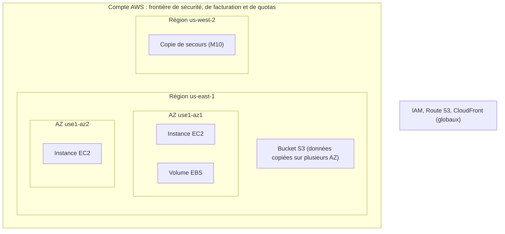
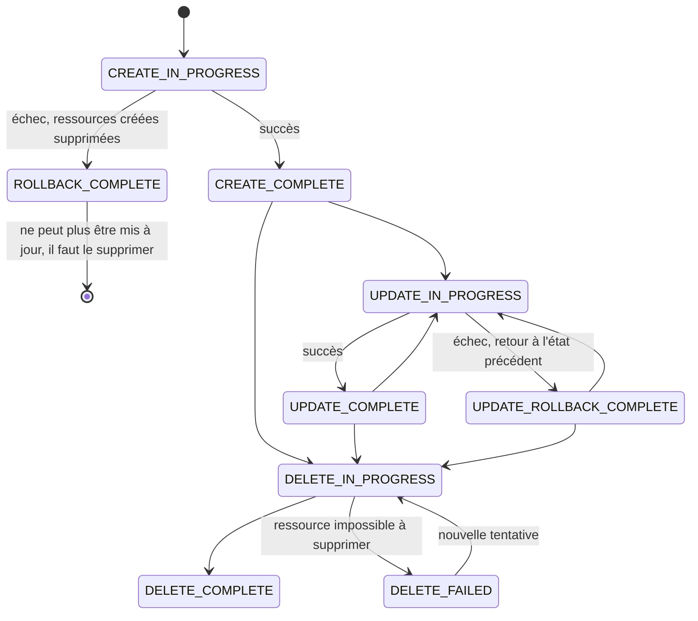
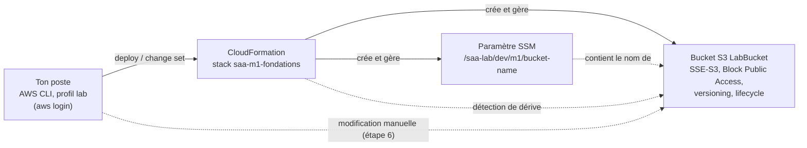

# Leçon 1 — Fondations architecturales : rayon d'impact, lecture d'énoncé et premiers stacks CloudFormation

> **Module :** M1 · **Difficulté :** ★ · **Durée :** ~6 h (théorie 2 h 30, lab 2 h, questions et exercices 1 h 30)
> **Domaine d'examen :** D2 (résilience), avec des liens vers D1 et D4
> **Lab :** niveau 1 (découverte), avec un échec volontaire et une dérive provoquée
> **Corrigé :** fichier séparé `lecon-01-corrige.md`. Ne l'ouvre qu'après m'avoir envoyé tes réponses.
> **Fichiers du lab :** `m1-v1.yaml`, `m1-v2.yaml`, `m1-v3-echec.yaml`.

Légende (identique à la leçon 0) :
- 📘 **Fait documenté** : vérifié dans la documentation AWS (vérifié le 11/10/2026).
- 🏗️ **Recommandation d'architecture** : bonne pratique, discutable selon le contexte.
- ✂️ **Simplification pédagogique** : volontairement simplifié pour ce stade du cours.

Tu peux découper la leçon en trois séances : **partie 1 (sections 1 à 4)**, **partie 2 (sections 5 à 7 et questions)**, **partie 3 (lab)**.

---

# Partie théorique

## 1. Le problème

Une petite société de e-commerce, *KafeAyiti*, vend du café en ligne. Son site tourne sur **une seule machine virtuelle**, dans **une seule zone de disponibilité**, configurée **à la main** dans la console il y a deux ans. Personne ne sait plus exactement quels réglages ont été faits.

Trois incidents arrivent la même année :

1. **Une panne de zone de disponibilité** coupe le site pendant 4 heures en pleine période de fêtes. Le serveur était « sur AWS », donc l'équipe croyait qu'AWS s'occupait de la disponibilité.
2. **Un développeur modifie un réglage de sécurité** dans la console pour déboguer un problème, puis oublie de le remettre. Le bucket de factures reste mal configuré pendant trois semaines.
3. **L'équipe veut créer un environnement de test identique à la production.** Il faut deux jours de clics, et le résultat n'est pas identique.

Ces trois incidents ont la même racine : **aucune réflexion sur l'étendue des pannes**, et **une infrastructure qui n'existe que dans la tête des gens et dans l'état actuel de la console**.

Ce que tu vas apprendre à faire :

- Pour chaque composant, savoir **ce qui tombe avec lui** quand il tombe (son rayon d'impact).
- Lire un énoncé d'examen comme un **cahier des charges** : extraire les exigences, puis éliminer les options qui en violent une.
- Décrire l'infrastructure **en code** pour la créer, la modifier, la vérifier et la supprimer de façon reproductible.

---

## 2. L'idée fondamentale

### Intuition

Imagine un immeuble. Une ampoule grillée ne touche qu'une pièce. Une coupure de courant à l'étage touche tout l'étage. Un incendie touche tout l'immeuble. Un bon architecte place les choses importantes **dans plusieurs étages, voire plusieurs immeubles**, selon la gravité de la panne qu'il veut survivre.

Sur AWS, les « niveaux » sont : **la ressource → la zone de disponibilité (AZ) → la Région → le compte**. Chaque niveau est une **frontière d'isolation des pannes** (fault isolation boundary).

### Explication technique

> **À retenir :** une architecture survit à une panne de niveau N **seulement si** ses composants critiques sont répartis sur **plusieurs instances indépendantes du niveau N**. Être « sur AWS » ne rend rien redondant par magie : c'est **le choix des services et leur configuration** qui détermine le rayon d'impact.

Le raisonnement qui en découle :

1. Pour chaque service, identifie **sa portée** : zonale, régionale ou globale.
2. Une ressource **zonale** (instance EC2, volume EBS, sous-réseau) meurt avec son AZ. Il faut donc **plusieurs copies dans plusieurs AZ**.
3. Une ressource **régionale managée** (S3, DynamoDB, SQS) est déjà répartie sur plusieurs AZ par AWS. Elle survit à la perte d'une AZ, mais pas à celle de la Région.
4. Survivre à la perte d'une Région demande une **architecture multi-Régions**, beaucoup plus coûteuse et complexe. On ne le fait que si une exigence l'impose (M10).

Et pour que ce raisonnement reste vrai dans le temps, l'infrastructure doit être **déclarée en code** : sinon, la réalité dérive du plan au fil des clics.

---

## 3. Les mécanismes

### 3.1 L'infrastructure globale AWS

📘 **Chiffres au 08/10/2026** (ils changent souvent, l'examen ne les demande jamais) : 39 Régions, 124 AZ, 750+ points de présence CloudFront, 46 Local Zones, 33 zones Wavelength. Deux Régions sont annoncées (Arabie saoudite, Chili).

| Élément | Ce que c'est | Pourquoi un architecte s'y intéresse |
|---|---|---|
| **Région** | Zone géographique isolée, avec au moins 3 AZ 📘 | Conformité et résidence des données, latence vers les utilisateurs, disponibilité des services, prix |
| **Zone de disponibilité (AZ)** | Un ou plusieurs datacenters avec alimentation, réseau et connectivité redondants, physiquement séparés des autres AZ de la Région | Unité de base de la haute disponibilité. Latence faible entre AZ (de l'ordre de la milliseconde), ce qui permet la réplication **synchrone** |
| **Local Zone** | Extension d'une Région placée près d'une grande ville, avec un sous-ensemble de services (EC2, EBS…). **Activation (opt-in) nécessaire** 📘 | Latence de quelques millisecondes vers des utilisateurs d'une métropole (montage vidéo, jeux, trading) |
| **Wavelength Zone** | Infrastructure AWS **dans le réseau 5G d'un opérateur télécom** | Latence ultra-faible pour des terminaux mobiles 5G : le trafic ne quitte pas le réseau de l'opérateur |
| **Outposts** | Racks AWS installés **dans ton propre datacenter**, gérés par AWS | Traitement local, résidence stricte des données, faible latence vers des systèmes sur site |
| **Dedicated Local Zones** | Local Zone réservée à un client | Exigences de souveraineté (gouvernements, secteurs réglementés) |
| **Points de présence (edge)** | Sites CloudFront, Route 53, Global Accelerator | Rapprocher le contenu et l'entrée réseau des utilisateurs (vu en détail au M4) |

#### Nom d'AZ et ID d'AZ : un piège réel

📘 Le **nom** d'une AZ (`us-east-1a`) est une étiquette propre à ton compte. L'**ID** d'AZ (`use1-az1`) désigne toujours le même emplacement physique, dans tous les comptes.

📘 **Nouveauté :** pour les comptes créés **avant novembre 2025**, dans les Régions les plus anciennes, AWS associe les noms aux emplacements physiques **différemment pour chaque compte**. Ton `us-east-1a` n'est donc pas forcément le `us-east-1a` d'un autre compte. Les comptes créés **à partir de novembre 2025** reçoivent tous la même correspondance.

🏗️ Conséquence : quand deux comptes doivent se coordonner sur une même AZ physique (réseau partagé avec RAM, latence minimale entre comptes), **raisonne en ID d'AZ, jamais en nom**.

### 3.2 La portée des services : zonale, régionale, globale

✂️ Classification simplifiée, suffisante pour l'examen :

| Portée | Exemples | Que se passe-t-il si **une AZ** tombe ? |
|---|---|---|
| **Zonale** | Instance EC2, volume EBS, sous-réseau, NAT Gateway en mode zonal (le mode classique), instance RDS Single-AZ | **La ressource devient indisponible** |
| **Régionale, répartie par AWS** | S3 (sauf One Zone-IA), DynamoDB, SQS, SNS, Lambda, EFS Regional | Le service continue de fonctionner |
| **Régionale, à répartir toi-même** | VPC (tu choisis les sous-réseaux), ALB (tu choisis les AZ), Auto Scaling group | Survit **si** tu l'as configuré sur plusieurs AZ |
| **Globale** | IAM, Route 53, CloudFront, Organizations | Non concerné par la perte d'une AZ |

Trois nuances importantes :

- 📘 Depuis novembre 2025, une NAT Gateway peut aussi être créée en **mode régional**, qui la répartit sur les AZ du VPC. Le mode zonal reste celui que décrivent la plupart des questions d'examen. On compare les deux au M4.
- 📘 Le **nom** d'un bucket S3 est unique dans le monde entier, mais le **bucket** et ses données vivent dans **une seule Région**. S3 n'est pas « global » au sens de la résilience.
- ✂️ Un service « global » comme IAM a un plan de contrôle centralisé (création et modification des identités) et un plan de données réparti (authentification des requêtes). C'est un niveau de détail utile en pratique, rarement à l'examen.

### 3.3 Le rayon d'impact en image



Lecture du schéma :

- La perte de `use1-az1` emporte l'instance de gauche et son volume EBS, mais pas l'instance de droite ni le bucket.
- La perte de la Région emporte tout ce qui est dans `us-east-1`, sauf la copie en `us-west-2`.
- Une **erreur humaine ou une compromission du compte** peut tout emporter : c'est pourquoi le **compte** est la frontière la plus forte (leçon 0, et M2).

### 3.4 Modèle de responsabilité partagée : ce qu'il change pour un architecte

Tu connais le principe depuis Cloud Practitioner : AWS est responsable **de** la sécurité **du** cloud, toi de la sécurité **dans** le cloud. Pour un architecte, la conséquence la plus importante concerne la **disponibilité** :

- 📘 AWS garantit que **chaque AZ** est conçue pour être indépendante des autres.
- 🏗️ **C'est à toi** de répartir ta charge de travail sur plusieurs AZ. AWS ne déplace pas ton instance EC2 dans une autre AZ si la sienne tombe.
- 🏗️ Plus le service est **managé**, plus AWS prend en charge de responsabilités : avec RDS Multi-AZ, AWS gère la réplication et le basculement. Avec une base installée sur EC2, tout est à ta charge.

C'est une idée qui revient sans cesse à l'examen : **« le moins d'effort opérationnel » pointe presque toujours vers le service le plus managé** qui satisfait les exigences.

### 3.5 Haute disponibilité, tolérance aux pannes, reprise après sinistre

Ces trois termes sont souvent confondus, et l'examen joue sur leurs différences.

| Concept | Question posée | Exemple | Coût relatif |
|---|---|---|---|
| **Haute disponibilité (HA)** | Le service reste-t-il **globalement** disponible, avec éventuellement une courte interruption ? | 2 instances dans 2 AZ derrière un load balancer ; une instance meurt, la seconde prend le relais | Moyen |
| **Tolérance aux pannes (FT)** | Le service continue-t-il **sans aucune interruption ni dégradation** ? | Capacité suffisante dans chaque AZ pour absorber seule toute la charge | Élevé |
| **Reprise après sinistre (DR)** | Peut-on **restaurer** le service après un événement majeur, dans un délai (RTO) et avec une perte de données (RPO) acceptables ? | Sauvegardes copiées dans une autre Région | De faible à très élevé selon la stratégie (M10) |

🏗️ Exemple chiffré pour sentir la différence : une application a besoin de **4 instances** pour tenir la charge.

- **HA sur 2 AZ** : 2 + 2 instances. Si une AZ tombe, il en reste 2 : le service reste en ligne, **dégradé**, le temps que l'Auto Scaling relance des instances.
- **FT sur 2 AZ** : 4 + 4 instances. Si une AZ tombe, il en reste 4 : **aucune dégradation**. Coût : le double.
- **FT sur 3 AZ** : 2 + 2 + 2 instances. Si une AZ tombe, il en reste 4 : **aucune dégradation**, pour 1,5 fois le besoin. Répartir sur plus d'AZ réduit le surcoût de la tolérance aux pannes.

### 3.6 Le Well-Architected Framework, version « examen »

📘 Le framework (révision du 6 novembre 2024) compte **6 piliers**. Quatre d'entre eux correspondent directement aux domaines de l'examen :

| Pilier | Domaine SAA-C03 | Question que le pilier te fait poser |
|---|---|---|
| Sécurité | D1 (30 %) | Qui peut faire quoi, et comment protéger les données ? |
| Fiabilité | D2 (26 %) | Que se passe-t-il quand un composant tombe, et comment le système récupère-t-il ? |
| Efficacité des performances | D3 (24 %) | Le bon type de ressource, à la bonne taille, au bon endroit ? |
| Optimisation des coûts | D4 (20 %) | Paie-t-on seulement ce dont on a besoin ? |
| Excellence opérationnelle | Transversal | Peut-on déployer, observer et corriger de façon fiable ? |
| Durabilité | Transversal | Consomme-t-on le moins de ressources possible ? |

🏗️ Ce qu'il faut retenir pour l'examen : **les piliers sont en tension**. Ajouter une AZ améliore la fiabilité mais augmente le coût. Chiffrer avec une clé gérée par le client améliore le contrôle mais ajoute de la gestion. **L'énoncé dit toujours quel pilier prime**, grâce à ses mots-clés (section 6).

Quelques principes de conception qui reviennent dans les scénarios :

- **Fiabilité :** récupérer automatiquement après une panne ; tester les procédures de reprise ; augmenter la capacité horizontalement plutôt que verticalement ; ne plus deviner la capacité.
- **Excellence opérationnelle :** faire des changements **fréquents, petits et réversibles** ; **gérer l'infrastructure comme du code**.
- **Coûts :** adopter un modèle de consommation (payer à l'usage) ; mesurer l'efficacité globale.

### 3.7 L'Infrastructure as Code avec CloudFormation

#### Le principe

Un **template** (YAML ou JSON) décrit l'état voulu. CloudFormation le compare à l'état actuel du **stack** et calcule les appels API nécessaires pour passer de l'un à l'autre. Tu décris **quoi**, CloudFormation décide **comment** et dans quel ordre.

📘 **Coût :** aucun frais CloudFormation pour les types de ressources `AWS::*`. Tu paies seulement les ressources créées, aux tarifs habituels. Seules les opérations de fournisseurs tiers et de hooks personnalisés sont facturées.

📘 **Plan gratuit :** CloudFormation est disponible, mais **pas les StackSets** (déploiement multi-comptes et multi-Régions). On les verra en théorie au M11.

#### Anatomie d'un template

```yaml
AWSTemplateFormatVersion: '2010-09-09'   # facultatif, une seule valeur possible
Description: À quoi sert ce stack

Parameters:      # valeurs fournies au déploiement (environnement, taille…)
Mappings:        # tables de correspondance (par exemple, par Région)
Conditions:      # créer une ressource seulement si…
Resources:       # SEULE section obligatoire
Outputs:         # valeurs exposées après déploiement (nom, ARN, URL…)
```

Les fonctions intrinsèques à connaître dès maintenant :

| Fonction | Rôle | Exemple dans le lab |
|---|---|---|
| `!Ref` | Valeur d'un paramètre, ou identifiant principal d'une ressource | `!Ref LabBucket` donne le **nom** du bucket |
| `!GetAtt` | Attribut d'une ressource | `!GetAtt LabBucket.Arn` donne son **ARN** |
| `!Sub` | Substitution de variables dans une chaîne | `!Sub /saa-lab/${Environnement}/m1/bucket-name` |
| Pseudo-paramètres | Valeurs fournies par AWS | `${AWS::AccountId}`, `${AWS::Region}` |

🏗️ Un `!Ref` ou un `!GetAtt` crée une **dépendance implicite** : CloudFormation crée d'abord la ressource référencée, et la supprime en dernier.

#### Identifiant logique et identifiant physique

- L'**ID logique** (`LabBucket`) est le nom de la ressource **dans le template**.
- L'**ID physique** (`saa-m1-fondations-labbucket-1a2b3c4d5e6f`) est le nom réel chez AWS.

🏗️ Ne fixe pas le nom physique d'une ressource quand ce n'est pas nécessaire. Laisser CloudFormation le générer évite les collisions, permet de déployer deux fois le même template, et autorise les remplacements (voir plus bas).

#### Le cycle de vie d'un stack



Le point clé : **une opération échouée est annulée** (rollback). Le stack revient à son dernier état stable au lieu de rester à moitié modifié. Tu vas le provoquer volontairement dans le lab.

#### Les comportements de mise à jour

📘 Pour chaque propriété d'une ressource, la documentation CloudFormation indique ce qu'implique sa modification :

| Comportement | Effet | Exemple |
|---|---|---|
| **No interruption** | Modification en place, sans coupure | Ajouter une règle de lifecycle à un bucket |
| **Some interruption** | Modification en place, avec une courte coupure | Changer le type d'une instance EC2 (arrêt puis redémarrage) |
| **Replacement** | **Nouvelle ressource créée, ancienne supprimée** | Changer le nom d'un bucket ou d'un paramètre SSM |

⚠️ Un remplacement sur une ressource qui contient des données (base de données, bucket) peut être **destructeur**. D'où l'intérêt des **change sets** : ils montrent, **avant exécution**, les ressources ajoutées, modifiées, supprimées, et si un remplacement aura lieu (`Replacement: True`, `False` ou `Conditional`).

#### Protéger les ressources qui contiennent des données

📘 L'attribut `DeletionPolicy` décide du sort d'une ressource quand elle est supprimée du stack :

| Valeur | Effet |
|---|---|
| `Delete` | Valeur par défaut pour la plupart des ressources : la ressource est supprimée. Un bucket S3 doit être vide pour que cela réussisse |
| `Retain` | La ressource est conservée (et reste facturée), mais sort de la gestion de CloudFormation |
| `RetainExceptOnCreate` | Comme `Retain`, sauf si la ressource vient d'être créée et que l'opération est annulée |
| `Snapshot` | Instantané avant suppression, pour les ressources qui le permettent (volumes EBS, RDS, ElastiCache, Redshift…) |

📘 Exception à connaître : `AWS::RDS::DBCluster` et `AWS::RDS::DBInstance` (hors cluster) ont `Snapshot` comme valeur par défaut.

📘 `DeletionPolicy` **ne s'applique pas** quand une mise à jour **remplace** une ressource. Pour ce cas, il existe un attribut distinct, `UpdateReplacePolicy`. Autre protection utile : la **protection contre la suppression** (termination protection) du stack entier.

#### La dérive (drift)

📘 La **détection de dérive** compare la configuration réelle des ressources avec celle attendue par le template. Elle **signale** les écarts, mais **ne les corrige pas**.

🏗️ Et redéployer le même template ne les corrige pas non plus : CloudFormation compare le **nouveau template à l'ancien**, pas le template à la réalité. Tu le vérifieras dans le lab.

---

## 4. Les décisions architecturales

### 4.1 Choisir une Région

| Critère | Question | Poids habituel |
|---|---|---|
| **Conformité et résidence des données** | Une loi ou un contrat impose-t-il que les données restent dans un pays ? | **Éliminatoire** : il passe avant tout le reste |
| **Latence** | Où sont les utilisateurs ? | Élevé pour une application interactive |
| **Disponibilité des services** | Les services nécessaires existent-ils dans cette Région ? | Éliminatoire si un service manque |
| **Prix** | Le même service coûte-t-il moins cher ailleurs ? | Variable : les écarts entre Régions peuvent être notables |

🏗️ L'ordre compte : on **élimine** d'abord les Régions interdites ou incomplètes, puis on **optimise** latence et coût parmi celles qui restent.

### 4.2 Choisir le niveau de redondance

| Option | Survit à | Disponibilité | Coût | Complexité | Quand l'utiliser |
|---|---|---|---|---|---|
| **Une seule AZ** | Une panne de ressource, si elle est remplacée automatiquement | Faible | Le plus bas | Faible | Développement, tests, traitements interruptibles |
| **Multi-AZ** | La perte d'une AZ | Élevée | Modéré | Modérée | **Par défaut en production** 🏗️ |
| **Multi-Régions, passif** (sauvegardes, pilot light) | La perte d'une Région, avec un délai de reprise | Élevée après reprise | Variable | Élevée | Exigence de reprise après sinistre (M10) |
| **Multi-Régions, actif-actif** | La perte d'une Région, presque sans interruption | Très élevée | Le plus élevé | Très élevée | Exigence de disponibilité extrême, ou utilisateurs répartis mondialement |

### 4.3 Choisir l'outil d'infrastructure as code

| Outil | Description | Quand le préférer |
|---|---|---|
| **CloudFormation** | Templates YAML/JSON, service natif AWS | Référence de l'examen ; aucune installation ; fondation des autres outils AWS |
| **AWS CDK** | Code (TypeScript, Python…) qui **génère** du CloudFormation | Équipes de développeurs, logique complexe, abstractions réutilisables |
| **AWS SAM** | Extension de CloudFormation pour le serverless | Applications Lambda et API Gateway (M8) |
| **Terraform** (tiers) | Outil multi-fournisseurs, avec son propre fichier d'état | Organisations multi-cloud. Hors examen |

À l'examen, **« reproductible », « environnements identiques », « déployer dans plusieurs comptes ou Régions »** pointent vers CloudFormation (et StackSets pour le multi-comptes).

---

## 5. Exemple concret : remettre KafeAyiti d'aplomb

Exigences reformulées à partir des incidents :

1. Le site doit rester disponible si une AZ tombe.
2. Les données (catalogue, factures) ne doivent pas être perdues.
3. Les environnements de test et de production doivent être identiques, et toute modification manuelle doit être repérée.
4. Le budget est limité : pas de multi-Régions sans exigence explicite.

| Exigence | Décision | Pourquoi |
|---|---|---|
| 1 | Deux instances ou plus, dans deux AZ ou plus, derrière un load balancer (M5) | Supprime le point unique de défaillance au niveau AZ |
| 2 | Factures dans S3, avec versioning | S3 réplique sur plusieurs AZ ; le versioning protège contre l'écrasement et la suppression accidentelle |
| 3 | Toute l'infrastructure en CloudFormation, un paramètre `Environnement` ; détection de dérive régulière | Même template, même résultat ; la dérive signale les clics manuels |
| 4 | Une seule Région, choisie pour la latence vers les clients et le prix | Le multi-Régions n'est pas demandé : il ajouterait coût et complexité |

Le lab de cette leçon construit **la brique « données » et la discipline IaC** de cette solution. Les instances et le load balancer arriveront au M5.

---

## 6. Pièges de l'examen

### 6.1 Lire un énoncé comme une liste d'exigences

C'est la compétence la plus rentable de tout le cours. Méthode en 4 étapes :

1. **Lis la dernière phrase en premier** : elle dit ce qu'on te demande (« Quelle solution… avec le moins d'effort opérationnel ? »).
2. **Souligne les exigences** : fonctionnelles (ce que le système fait) et non fonctionnelles (disponibilité, coût, délai, sécurité).
3. **Repère le critère de départage** : quand plusieurs options fonctionnent, c'est lui qui tranche.
4. **Élimine** chaque option qui viole **une seule** exigence. Ne cherche pas la meilleure option dans l'absolu : cherche celle qui satisfait **toutes** les exigences.

Tu as déjà vu cette méthode à la Q2 de la leçon 0, avec le mot « prévues ».

### 6.2 Les mots-clés qui changent la réponse

| Mot-clé | Ce qu'il implique généralement | Limite de cette règle |
|---|---|---|
| « le moins d'effort opérationnel » | Service managé ou serverless, fonctionnalité native | Si aucune option managée ne satisfait une exigence, elle est éliminée quand même |
| « le plus rentable », « le moins cher » | Le minimum qui satisfait les exigences | Une option bon marché qui viole la disponibilité exigée est fausse |
| « hautement disponible » | Multi-AZ | **Pas** forcément multi-Régions |
| « tolérant aux pannes », « sans interruption » | Capacité suffisante même après la perte d'une AZ | Plus coûteux que la simple HA |
| « reprise après sinistre », « panne régionale » | Autre Région | Le RTO et le RPO déterminent la stratégie (M10) |
| « latence la plus faible pour des utilisateurs mobiles 5G » | Wavelength | Pour une métropole sans mention de 5G, plutôt Local Zone |
| « les données doivent rester dans le pays X » | Région dans ce pays, ou Outposts / Local Zone si aucune Région n'existe | Exigence éliminatoire |
| « reproductible », « environnements identiques » | CloudFormation | — |
| « détecter les modifications manuelles » | Détection de dérive CloudFormation, ou AWS Config | Config va plus loin (historique, règles) ; on le voit au M3 |

### 6.3 Les confusions fréquentes

- **« S3 est global. »** Faux : le **nom** est unique dans le monde, les **données** sont dans une Région.
- **« Une Auto Scaling group dans une seule AZ est hautement disponible. »** Faux : elle remplace une instance défaillante, mais meurt avec l'AZ.
- **« Multi-Régions = plus de disponibilité, donc toujours mieux. »** Faux à l'examen si l'énoncé ne l'exige pas : le coût et la complexité rendent l'option incorrecte.
- **« Redéployer le template corrige la dérive. »** Faux, tu vas le voir dans le lab.
- **« `us-east-1a` est le même datacenter pour tous les comptes. »** Faux pour les comptes anciens ; utilise l'ID d'AZ.
- **« Un stack en `ROLLBACK_COMPLETE` peut être mis à jour. »** Faux : après un échec de **création**, il faut le supprimer et le recréer.

---

## 7. Résumé

### Les concepts essentiels

- Chaque ressource a une **portée** (zonale, régionale, globale), qui définit son **rayon d'impact**.
- La haute disponibilité est **ta responsabilité** : AWS fournit des AZ indépendantes, tu dois t'en servir.
- **HA ≠ tolérance aux pannes ≠ reprise après sinistre**.
- Les 6 piliers Well-Architected sont **en tension** ; l'énoncé dit lequel prime.
- CloudFormation : template → stack ; rollback automatique ; change sets avant les mises à jour risquées ; `DeletionPolicy` pour les données ; la détection de dérive signale sans corriger.

### Les décisions à savoir prendre

- Choisir une Région : **conformité d'abord**, puis services, latence et coût.
- Choisir entre une AZ, multi-AZ et multi-Régions selon l'exigence exacte.
- Choisir entre Local Zone, Wavelength et Outposts selon où se trouve le besoin de latence ou de résidence.

### Les erreurs à éviter

- Supposer qu'un service est redondant sans vérifier sa portée.
- Ajouter du multi-Régions « par sécurité ».
- Modifier à la main une ressource gérée par CloudFormation.
- Fixer des noms physiques sans nécessité.

### Questions de vérification

Réponds en une ou deux phrases chacune.

1. Deux comptes de ton entreprise veulent placer des ressources dans le **même datacenter physique** pour minimiser la latence entre eux. Le premier compte annonce « nous sommes en `us-east-1a` ». Pourquoi est-ce insuffisant, et que faut-il échanger à la place ?
2. Une AZ de `us-east-1` tombe. Que deviennent : **(a)** une instance EC2 et son volume EBS dans cette AZ ; **(b)** un bucket S3 Standard de la Région ; **(c)** un utilisateur IAM ? Justifie chaque réponse par la portée du service.
3. La **création** d'un stack échoue, puis plus tard la **mise à jour** d'un autre stack échoue. Dans quel état final se trouve chacun, et que peux-tu faire ensuite avec chacun ?

---

## Questions de type SAA-C03

Pour chaque question, donne ta réponse **et une phrase de justification** (y compris pourquoi tu écartes au moins une autre option).

**Q1.** Une entreprise française déploie une application web pour des clients à Paris. Une réglementation impose que les données restent en France. L'application doit rester disponible si un datacenter tombe en panne. Quelle solution répond aux exigences de la manière la plus rentable ?

- A. Déployer l'application dans `eu-west-3` (Paris) sur une seule AZ, avec une Auto Scaling group qui remplace les instances défaillantes.
- B. Déployer l'application dans `eu-west-3` sur plusieurs AZ, derrière un Application Load Balancer.
- C. Déployer l'application en actif-actif dans `eu-west-3` et `eu-central-1` (Francfort), avec Route 53.
- D. Déployer l'application dans une Local Zone proche de Paris.

**Q2.** Une société développe une application de réalité augmentée pour smartphones. Les utilisateurs se connectent via le réseau 5G d'un opérateur partenaire. L'application exige la latence la plus faible possible entre le téléphone et le serveur de calcul. Quelle option AWS choisir ?

- A. AWS Local Zones
- B. AWS Wavelength
- C. Amazon CloudFront
- D. AWS Outposts

**Q3.** *(2 réponses)* Une équipe gère manuellement, dans la console, trois environnements (dev, test, prod) censés être identiques. Ils divergent régulièrement, et l'équipe découvre trop tard des modifications manuelles. Elle veut des environnements reproductibles et être capable de repérer les modifications manuelles, avec le moins d'effort opérationnel. Quelles actions choisir ?

- A. Décrire l'infrastructure dans un template CloudFormation, avec un paramètre pour l'environnement, et déployer un stack par environnement.
- B. Lancer régulièrement la détection de dérive CloudFormation sur chaque stack.
- C. Écrire des scripts bash qui appellent l'AWS CLI pour recréer chaque environnement chaque nuit.
- D. Exporter chaque semaine des captures d'écran de la configuration console et les comparer.
- E. Créer une AMI de chaque serveur chaque jour.

**Q4.** Un stack CloudFormation de production contient une base Amazon RDS. Un développeur doit modifier une propriété de la base dont la documentation indique « Update requires: Replacement ». L'entreprise veut éviter toute perte de données imprévue. Quelle démarche est la plus appropriée ?

- A. Lancer la mise à jour directement : CloudFormation annule toujours une opération destructrice.
- B. Créer un change set pour examiner l'impact, et définir `UpdateReplacePolicy: Snapshot` sur la base avant d'exécuter la mise à jour.
- C. Définir `DeletionPolicy: Delete` sur la base pour qu'elle soit supprimée proprement.
- D. Modifier la propriété directement dans la console RDS pour éviter le remplacement.

---

# Lab pratique — Cycle de vie complet d'un stack CloudFormation

## A. Objectif

Tu vas créer, faire évoluer, casser volontairement, faire dériver puis supprimer un stack CloudFormation, et **vérifier le comportement réel** à chaque étape.

| Compétence pratique | Concept de la leçon |
|---|---|
| Lire les AZ de ton compte avec leurs ID | Nom d'AZ et ID d'AZ (3.1) |
| Déployer un bucket sécurisé en code | Template, ID logique et physique, portée régionale de S3 (3.2, 3.7) |
| Prévoir puis lire un change set | Comportements de mise à jour (3.7) |
| Provoquer un échec et observer le rollback | Cycle de vie d'un stack (3.7) |
| Provoquer une dérive et constater que le redéploiement ne la corrige pas | Détection de dérive (3.7) |
| Rater puis réussir une suppression | `DeletionPolicy`, bucket versionné (3.7) |

## B. Scénario

Tu es l'architecte de KafeAyiti. Première brique de la remise en ordre : le **bucket de factures**, décrit en code. Exigences :

- chiffrement au repos, aucun accès public possible, versioning activé ;
- nettoyage automatique des anciennes versions et des envois incomplets, pour maîtriser le coût ;
- les autres applications doivent retrouver le nom du bucket sans le coder en dur : il est publié dans un paramètre Systems Manager ;
- toute modification manuelle doit pouvoir être repérée.

## C. Architecture cible



- **CloudFormation** est le seul à créer et modifier les ressources (sauf la modification volontaire de l'étape 6).
- **Le bucket** est régional : ses données sont réparties sur plusieurs AZ de `us-east-1` par AWS.
- **Le paramètre SSM** est le moyen standard de publier une valeur (ici, le nom du bucket) pour d'autres stacks ou applications.

## D. Prérequis

- Leçon 0 validée : profil `lab`, identité `lab-admin`, aucune clé d'accès.
- AWS CLI **2.32.0 ou plus récente** (pour `aws login`) : `aws --version`.
- Les trois templates `m1-v1.yaml`, `m1-v2.yaml`, `m1-v3-echec.yaml`, placés dans un dossier de travail, par exemple `~/saa-lab/m1/`.
- Région : `us-east-1`, comme à la leçon 0.

**Coût estimé : environ 0,00 USD.** CloudFormation et la détection de dérive sont sans frais pour les ressources `AWS::*`. Le bucket contiendra deux fichiers de quelques octets, et le paramètre SSM est un paramètre standard (sans frais de stockage). Les quelques requêtes S3 sont négligeables et, sur le plan gratuit, prises sur tes crédits. Tout est supprimé à la fin.

## E. Instructions de réalisation

> Avant chaque commande de test, **écris ta prédiction** du résultat. C'est le cœur du lab : comparer ce que tu attendais à ce qui se passe.

### Étape 1 — Ouvrir la séance

```bash
cd ~/saa-lab/m1
export AWS_PROFILE=lab
export AWS_REGION=us-east-1
export STACK=saa-m1-fondations
export OWNER="ton-prenom"   # même valeur qu'à la leçon 0
# Mêmes clés de tags qu'à la leçon 0 (conventions.md), au format de « cloudformation deploy »
export TAGS="Project=saa-lab Lesson=l1 Owner=$OWNER Environment=lab"

aws --version
aws sts get-caller-identity --query Arn --output text
```

Résultat attendu : un ARN qui se termine par `user/lab-admin`. Si la session a expiré : `aws login --profile lab --remote`.

### Étape 2 — Explorer l'infrastructure de ton compte

**T1 — Régions et AZ**

```bash
# Nombre de Régions activées pour ton compte
aws ec2 describe-regions --query 'length(Regions)'

# Régions à activation manuelle (opt-in) que tu n'as pas activées
aws ec2 describe-regions --all-regions \
  --query 'Regions[?OptInStatus==`not-opted-in`].RegionName' --output text

# AZ de us-east-1 : nom propre à ton compte et ID physique
aws ec2 describe-availability-zones \
  --filters Name=zone-type,Values=availability-zone \
  --query 'AvailabilityZones[].{Nom:ZoneName,ID:ZoneId,Etat:State}' --output table
```

Note dans `conventions.md` la correspondance nom ↔ ID de tes AZ, et la date de création de ton compte (avant ou après novembre 2025 ?).

**T2 — Local Zones rattachées à us-east-1**

```bash
aws ec2 describe-availability-zones --all-availability-zones \
  --filters Name=zone-type,Values=local-zone \
  --query 'AvailabilityZones[].{Nom:ZoneName,Groupe:GroupName,OptIn:OptInStatus}' --output table
```

Résultat attendu : une liste de Local Zones (par exemple dans des métropoles américaines), probablement avec `OptIn` à `not-opted-in`. **N'en active aucune** : ce n'est pas nécessaire pour le cours.

### Étape 3 — Premier déploiement (v1)

Lis d'abord `m1-v1.yaml` en entier. Repère la seule section obligatoire, l'ID logique du bucket, et l'absence de `BucketName`.

```bash
aws cloudformation validate-template --template-body file://m1-v1.yaml

aws cloudformation deploy \
  --stack-name "$STACK" \
  --template-file m1-v1.yaml \
  --tags $TAGS
```

> `$TAGS` est volontairement **sans guillemets** : le shell doit le découper en quatre arguments `Clé=Valeur`. La valeur d'`OWNER` ne doit donc pas contenir d'espace.
>
> 📘 `cloudformation deploy` applique ces tags au **stack** et les **propage** aux ressources qui acceptent les tags (ici le bucket et le paramètre SSM). Réutilise exactement les mêmes tags à chaque `deploy` du lab : en changer revient à modifier toutes les ressources.

`deploy` crée un change set, l'exécute, puis attend la fin. Résultat attendu : `Successfully created/updated stack - saa-m1-fondations`.

**T3 — Le stack et ses ressources**

```bash
aws cloudformation describe-stacks --stack-name "$STACK" \
  --query 'Stacks[0].{Statut:StackStatus,Sorties:Outputs}'

aws cloudformation describe-stack-resources --stack-name "$STACK" \
  --query 'StackResources[].{Logique:LogicalResourceId,Physique:PhysicalResourceId,Type:ResourceType}' \
  --output table

export BUCKET=$(aws cloudformation describe-stacks --stack-name "$STACK" \
  --query "Stacks[0].Outputs[?OutputKey=='BucketName'].OutputValue" --output text)
echo "$BUCKET"
```

Attendu : statut `CREATE_COMPLETE`, et un nom physique généré à partir du nom du stack et de l'ID logique.

**T4 — Test de sécurité du bucket**

```bash
aws s3api get-bucket-versioning --bucket "$BUCKET"
aws s3api get-public-access-block --bucket "$BUCKET"
aws s3api get-bucket-encryption --bucket "$BUCKET" \
  --query 'ServerSideEncryptionConfiguration.Rules[0].ApplyServerSideEncryptionByDefault'
aws s3api get-bucket-tagging --bucket "$BUCKET"
```

Attendu : `"Status": "Enabled"`, les quatre réglages Block Public Access à `true`, l'algorithme `AES256`, tes tags **et** des tags `aws:cloudformation:*` ajoutés automatiquement.

### Étape 4 — Faire évoluer le stack (v2) avec un change set

Compare `m1-v2.yaml` avec `m1-v1.yaml` : un paramètre, deux règles de lifecycle, un paramètre SSM et deux sorties ont été ajoutés.

**Avant de lancer quoi que ce soit, écris ta prédiction :** quelles actions (`Add`, `Modify`, `Remove`) le change set va-t-il afficher, sur quelles ressources, et le bucket sera-t-il remplacé ?

```bash
aws cloudformation deploy \
  --stack-name "$STACK" \
  --template-file m1-v2.yaml \
  --tags $TAGS \
  --no-execute-changeset

CS=$(aws cloudformation list-change-sets --stack-name "$STACK" \
  --query "Summaries[?Status=='CREATE_COMPLETE'] | [0].ChangeSetName" --output text)
echo "$CS"
```

**T5 — Lecture du change set**

```bash
aws cloudformation describe-change-set --stack-name "$STACK" --change-set-name "$CS" \
  --query 'Changes[].ResourceChange.{Action:Action,Ressource:LogicalResourceId,Remplacement:Replacement}' \
  --output table
```

Compare avec ta prédiction, puis exécute :

```bash
aws cloudformation execute-change-set --stack-name "$STACK" --change-set-name "$CS"
aws cloudformation wait stack-update-complete --stack-name "$STACK"
```

**T6 — Le nouveau comportement est réel**

```bash
aws s3api get-bucket-lifecycle-configuration --bucket "$BUCKET" \
  --query 'Rules[].{Id:ID,Statut:Status}'

aws ssm get-parameter --name /saa-lab/dev/m1/bucket-name \
  --query Parameter.Value --output text

aws cloudformation describe-stacks --stack-name "$STACK" \
  --query "Stacks[0].Outputs[?OutputKey=='BucketName'].OutputValue" --output text
```

Attendu : deux règles `Enabled`, et **trois fois le même nom** : `$BUCKET`, la valeur du paramètre SSM et la sortie du stack. Le bucket n'a donc pas été remplacé.

### Étape 5 — Échec volontaire et rollback (v3)

`m1-v3-echec.yaml` ajoute une bucket policy qui accorde l'accès à un utilisateur IAM **qui n'existe pas**. S3 refuse les policies dont le principal est invalide.

**Prédiction :** dans quel état sera le stack après l'échec ? Le bucket et le paramètre SSM existeront-ils encore ? Y aura-t-il une bucket policy ?

```bash
aws cloudformation deploy \
  --stack-name "$STACK" \
  --template-file m1-v3-echec.yaml \
  --tags $TAGS
```

Attendu : la commande échoue (message du type `Failed to create/update the stack`). C'est voulu.

**T7 — Test d'échec et de reprise**

```bash
aws cloudformation describe-stacks --stack-name "$STACK" \
  --query 'Stacks[0].StackStatus' --output text

aws cloudformation describe-stack-events --stack-name "$STACK" --max-items 20 \
  --query "StackEvents[?ResourceStatus=='CREATE_FAILED' || ResourceStatus=='UPDATE_FAILED'].{Ressource:LogicalResourceId,Statut:ResourceStatus,Raison:ResourceStatusReason}" \
  --output table

aws s3api get-bucket-policy --bucket "$BUCKET"
aws ssm get-parameter --name /saa-lab/dev/m1/bucket-name --query Parameter.Value --output text
```

Attendu :
- statut `UPDATE_ROLLBACK_COMPLETE` ;
- un événement `CREATE_FAILED` sur `LabBucketPolicy`, avec une raison qui mentionne un principal invalide (la formulation exacte peut varier) ;
- `get-bucket-policy` renvoie une erreur `NoSuchBucketPolicy` : le rollback a bien nettoyé ;
- le paramètre SSM existe toujours : le stack est revenu à la v2, intact et utilisable.

### Étape 6 — Dérive provoquée

Tu joues le développeur pressé de l'incident n° 2 : tu suspends le versioning **à la main**.

```bash
aws s3api put-bucket-versioning --bucket "$BUCKET" \
  --versioning-configuration Status=Suspended
```

> 📘 Un bucket dont le versioning a été activé ne peut plus jamais revenir à l'état « jamais versionné » : il ne peut être que `Enabled` ou `Suspended`.

**T8 — La dérive est détectée, mais pas corrigée par un redéploiement**

```bash
DRIFT_ID=$(aws cloudformation detect-stack-drift --stack-name "$STACK" \
  --query StackDriftDetectionId --output text)
sleep 20
aws cloudformation describe-stack-drift-detection-status \
  --stack-drift-detection-id "$DRIFT_ID" \
  --query '{Detection:DetectionStatus,Derive:StackDriftStatus}'

aws cloudformation describe-stack-resource-drifts --stack-name "$STACK" \
  --stack-resource-drift-status-filters MODIFIED \
  --query 'StackResourceDrifts[].PropertyDifferences[].{Propriete:PropertyPath,Attendu:ExpectedValue,Reel:ActualValue}' \
  --output table
```

Si `Detection` affiche encore `DETECTION_IN_PROGRESS`, attends quelques secondes et relance la commande `describe-stack-drift-detection-status`.

**Prédiction :** si tu redéploies `m1-v2.yaml` maintenant, le versioning sera-t-il réactivé ?

```bash
aws cloudformation deploy --stack-name "$STACK" \
  --template-file m1-v2.yaml --tags $TAGS
aws s3api get-bucket-versioning --bucket "$BUCKET"
```

Attendu : `DRIFTED`, une différence sur la propriété de versioning (attendu `Enabled`, réel `Suspended`), puis un message du type `No changes to deploy`, et le versioning **toujours** `Suspended`.

**T9 — Retour à la conformité**

```bash
aws s3api put-bucket-versioning --bucket "$BUCKET" \
  --versioning-configuration Status=Enabled

DRIFT_ID=$(aws cloudformation detect-stack-drift --stack-name "$STACK" \
  --query StackDriftDetectionId --output text)
sleep 20
aws cloudformation describe-stack-drift-detection-status \
  --stack-drift-detection-id "$DRIFT_ID" \
  --query '{Detection:DetectionStatus,Derive:StackDriftStatus}'
```

Attendu : `IN_SYNC`.

### Étape 7 — Suppression ratée, puis réussie

Ajoute deux versions d'un même fichier (aucune donnée réelle) :

```bash
echo "facture test - version 1" > note.txt
aws s3 cp note.txt "s3://$BUCKET/note.txt"
echo "facture test - version 2" > note.txt
aws s3 cp note.txt "s3://$BUCKET/note.txt"

aws s3api list-object-versions --bucket "$BUCKET" \
  --query 'Versions[].{Cle:Key,Version:VersionId,Actuelle:IsLatest}' --output table
```

**Prédiction :** la suppression du stack va-t-elle réussir ? Et que deviendra le paramètre SSM ?

```bash
aws cloudformation delete-stack --stack-name "$STACK"
aws cloudformation wait stack-delete-complete --stack-name "$STACK"
```

Attendu : le `wait` échoue (`Waiter StackDeleteComplete failed`). C'est voulu.

**T10 — Analyse de l'échec de suppression**

```bash
aws cloudformation describe-stacks --stack-name "$STACK" \
  --query 'Stacks[0].StackStatus' --output text

aws cloudformation describe-stack-events --stack-name "$STACK" --max-items 10 \
  --query "StackEvents[?ResourceStatus=='DELETE_FAILED'].{Ressource:LogicalResourceId,Raison:ResourceStatusReason}" \
  --output table

aws ssm get-parameter --name /saa-lab/dev/m1/bucket-name 2>&1 | tail -1
```

Attendu : `DELETE_FAILED`, une raison indiquant que le bucket n'est pas vide, et un paramètre SSM… à toi de constater.

Vide maintenant le bucket **complètement**, versions comprises :

```bash
aws s3api list-object-versions --bucket "$BUCKET" \
  --query '{Objects: [Versions, DeleteMarkers][][].{Key: Key, VersionId: VersionId}, Quiet: `true`}' \
  --output json > a-supprimer.json
cat a-supprimer.json

aws s3api delete-objects --bucket "$BUCKET" --delete file://a-supprimer.json
aws s3api list-object-versions --bucket "$BUCKET" --query '[Versions, DeleteMarkers]'
```

Attendu : `[null, null]`, c'est-à-dire plus aucune version ni marqueur de suppression.

> Pourquoi pas `aws s3 rm s3://$BUCKET --recursive` ? Sur un bucket versionné, cette commande ne supprime que la **version courante** en ajoutant un **marqueur de suppression**. Les anciennes versions restent, et le bucket n'est toujours pas vide.

**T11 — Suppression réussie et vérification**

```bash
aws cloudformation delete-stack --stack-name "$STACK"
aws cloudformation wait stack-delete-complete --stack-name "$STACK" && echo "stack supprimé"

aws cloudformation describe-stacks --stack-name "$STACK" 2>&1 | tail -1
aws s3api head-bucket --bucket "$BUCKET" 2>&1 | tail -1
```

Attendu : `stack supprimé`, puis une erreur `does not exist` pour le stack, et une erreur `404` (Not Found) pour le bucket.

## F. Tests et validation (récapitulatif)

| Test | Type | Prouve que… |
|---|---|---|
| T1, T2 | Exploration | Tu sais lire la topologie réelle de ton compte (noms et ID d'AZ, Local Zones) |
| T3 | Fonctionnement normal | Le stack existe et tu distingues ID logique et physique |
| T4 | Sécurité | Le bucket est chiffré, privé et versionné, **en vrai** |
| T5, T6 | Évolution | Le change set prévoit correctement l'impact, et la modification se fait sans remplacement |
| T7 | Échec et reprise | Une mise à jour ratée laisse le stack dans son état précédent, propre |
| T8, T9 | Conformité | La dérive est détectée, n'est pas corrigée par un redéploiement, et l'est par une remise en conformité |
| T10, T11 | Nettoyage | Tu sais pourquoi une suppression échoue et comment la terminer proprement |

## G. Exercices de réflexion

Propose ta solution dans le chat **avant** d'ouvrir le corrigé.

1. **Choisir une Région pour Haïti.** Une association de Port-au-Prince veut héberger une application de prise de rendez-vous pour des patients en Haïti. Il n'existe pas de Région AWS dans les Caraïbes. Quels critères appliques-tu, dans quel ordre, et quelle Région proposerais-tu au départ ? Quelle information manquante pourrait changer complètement ta réponse ?
2. **Trouver le maillon faible.** Une application tourne sur 4 instances EC2 réparties sur 2 AZ derrière un ALB. Elle utilise une base RDS **Single-AZ** et une seule NAT Gateway en mode zonal pour que les instances privées appellent une API de paiement externe. Quels sont les points uniques de défaillance au niveau AZ ? Lequel corrigerais-tu en premier, et à quel prix approximatif en complexité et en coût ?
3. **Le `delete-stack` de trop.** Un collègue a supprimé par erreur le stack de production qui contenait le bucket de factures. Il n'a échoué que parce que le bucket n'était pas vide, mais le paramètre SSM a disparu. Propose au moins **trois protections complémentaires** pour que cela ne puisse plus arriver, ou pour que la perte de données soit impossible même si quelqu'un le refait.

## H. Dépannage

| Symptôme | Cause probable | Diagnostic |
|---|---|---|
| `ExpiredToken` ou erreur de session | Session `aws login` expirée | `aws login --profile lab --remote`, puis `aws sts get-caller-identity` |
| `AccessDenied` sur `cloudformation:*` ou `ssm:*` | Mauvais profil, ou policy de refus de budget active | `aws sts get-caller-identity` ; si une action de budget a appliqué un refus, intervention en root (leçon 0) |
| `No changes to deploy` à l'étape 4 | Mauvais fichier passé à `--template-file` | Vérifie le nom du fichier et `diff m1-v1.yaml m1-v2.yaml` |
| `$CS` vaut `None` | Le change set a échoué ou n'a pas été créé | `aws cloudformation list-change-sets --stack-name "$STACK"` et lis `StatusReason` |
| À l'étape 5, l'échec arrive **avant** toute modification, avec un statut du stack inchangé | Une validation préalable a rejeté la policy avant l'exécution | C'est aussi un échec valide : note le message exact et le statut, et envoie-les-moi |
| `ROLLBACK_COMPLETE` dès la première création | La création initiale a échoué (souvent un problème de permissions ou de syntaxe) | Lis les événements ; un tel stack doit être **supprimé** puis recréé |
| Le stack reste en `UPDATE_ROLLBACK_FAILED` | Une ressource n'a pas pu revenir à son état précédent | `describe-stack-events` ; puis `aws cloudformation continue-update-rollback` après correction de la cause |
| `delete-objects` renvoie une erreur sur `Objects` | Le fichier JSON est vide (bucket déjà vide) | `cat a-supprimer.json` : si `Objects` est `[]`, passe directement à T11 |
| `BUCKET` est vide dans une commande | Nouvelle session de terminal, variables perdues | Réexécute les `export` de l'étape 1 et la commande qui définit `BUCKET` |

## I. Nettoyage

| Ressource | État après T11 | Coût |
|---|---|---|
| Stack `saa-m1-fondations` | Supprimé | — |
| Bucket S3 et ses versions | Supprimés | — |
| Paramètre SSM | Supprimé | — |
| Change sets | Supprimés avec le stack | — |
| Fichiers locaux `note.txt`, `a-supprimer.json` | À supprimer : `rm note.txt a-supprimer.json` | — |
| Templates `m1-*.yaml` | **À conserver** : on les réutilisera | — |

Vérification finale :

```bash
aws cloudformation list-stacks \
  --stack-status-filter CREATE_COMPLETE UPDATE_COMPLETE UPDATE_ROLLBACK_COMPLETE DELETE_FAILED ROLLBACK_COMPLETE \
  --query 'StackSummaries[].{Nom:StackName,Statut:StackStatus}' --output table
aws s3 ls
aws logout --profile lab
```

Attendu : aucun stack `saa-m1-*`, et aucun bucket de ce lab dans la liste.

## J. Livrables et critères de réussite

**À me fournir dans le chat** (sans secret, ID de compte masqué, code d'autorisation masqué) :

1. Tes réponses aux 3 questions de vérification et aux questions Q1 à Q4, avec une justification par réponse.
2. Les sorties de **T1** (table des AZ), **T5**, **T7**, **T8** et **T10**.
3. Pour T5, T7, T8 et T10 : **ta prédiction écrite avant la commande**, et ce qui différait éventuellement.
4. Tes solutions aux 3 exercices de réflexion.

**Le lab est réussi si :**

- [ ] T1 montre la correspondance nom ↔ ID de tes AZ, notée dans `conventions.md`.
- [ ] T4 confirme chiffrement, Block Public Access et versioning.
- [ ] T5 montre `Modify` sans remplacement sur le bucket et `Add` sur le paramètre SSM.
- [ ] T7 montre `UPDATE_ROLLBACK_COMPLETE` et l'absence de bucket policy.
- [ ] T8 montre `DRIFTED` puis `No changes to deploy` avec le versioning toujours suspendu ; T9 montre `IN_SYNC`.
- [ ] T10 montre `DELETE_FAILED` avec la raison ; T11 montre le stack et le bucket supprimés.
- [ ] Tu sais expliquer, en une phrase chacun, les résultats de T7, T8 et T10.

## K. Solution de référence

👉 Dans le fichier séparé `lecon-01-corrige.md`.

---

## Références

- Infrastructure globale AWS : https://aws.amazon.com/about-aws/global-infrastructure/
- Zones de disponibilité et ID d'AZ : https://docs.aws.amazon.com/global-infrastructure/latest/regions/aws-availability-zones.html
- AWS Well-Architected Framework : https://docs.aws.amazon.com/wellarchitected/latest/framework/welcome.html
- Guide de l'utilisateur CloudFormation : https://docs.aws.amazon.com/AWSCloudFormation/latest/UserGuide/Welcome.html
- Comportements de mise à jour des ressources : https://docs.aws.amazon.com/AWSCloudFormation/latest/UserGuide/using-cfn-updating-stacks-update-behaviors.html
- Change sets : https://docs.aws.amazon.com/AWSCloudFormation/latest/UserGuide/using-cfn-updating-stacks-changesets.html
- Attribut `DeletionPolicy` : https://docs.aws.amazon.com/AWSCloudFormation/latest/UserGuide/aws-attribute-deletionpolicy.html
- Détection de dérive : https://docs.aws.amazon.com/AWSCloudFormation/latest/UserGuide/using-cfn-stack-drift.html
- Ressource `AWS::S3::Bucket` : https://docs.aws.amazon.com/AWSCloudFormation/latest/TemplateReference/aws-resource-s3-bucket.html
- Tarifs CloudFormation : https://aws.amazon.com/cloudformation/pricing/
- Services disponibles sur le plan gratuit : https://docs.aws.amazon.com/accounts/latest/reference/supported-services-sign-up-new.html